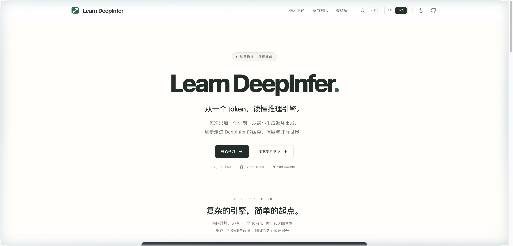
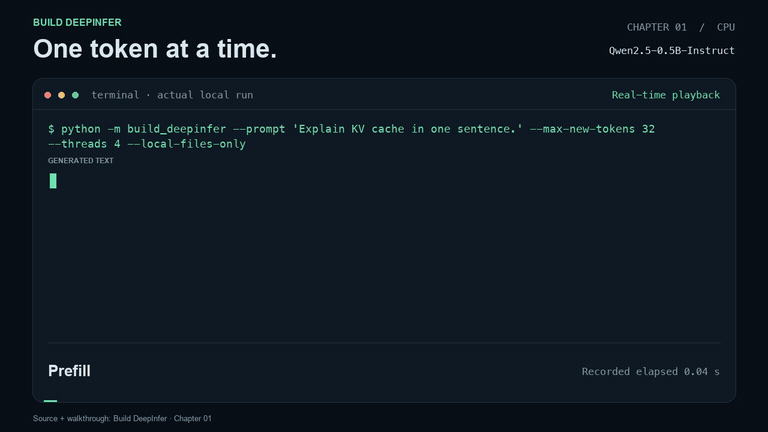

<div align="center">

<a href="https://learn-deepinfer.github.io/en/">
  
</a>

# Learn DeepInfer

**Understand inference. One token at a time.**

12 lessons to explore inference engines, with a CPU implementation you can run.

[English](README.md) · [简体中文](README.zh-CN.md)

[](https://github.com/learn-deepinfer/learn-deepinfer.github.io/actions/workflows/pages.yml) [](LICENSE) [](https://learn-deepinfer.github.io/en/timeline/)

**[Start learning →](https://learn-deepinfer.github.io/en/)** · **[中文教程 →](https://learn-deepinfer.github.io/zh/)** · [Run Chapter 1](#run-chapter-1-on-your-cpu)

</div>

---

Start with a loop that generates real text. Then follow the ideas behind KV caching, batching, scheduling, and distributed experts through small code excerpts and pinned [DeepInfer](https://github.com/deepseek-ai/DeepInfer) source links.

**No GPU is needed to read the course, explore the interactive demos, or run Chapter 1.**

<a href="https://learn-deepinfer.github.io/en/">
  
</a>

## Explore the course

| Read | Trace | Try | Compare |
| :--- | :--- | :--- | :--- |
| Chinese and English lessons, exercises, and source links | Follow a request through four architecture layers | Step, play, reset, and scrub through mechanism demos | Compare the ideas and code behind two chapters |

The website includes search, light and dark themes, mobile layouts, and reading progress saved in your browser.

### One mechanism per lesson

| | Lesson | What you will explore |
| :---: | :--- | :--- |
| `s01` | [The Token Loop](https://learn-deepinfer.github.io/en/s01/) | Tokenization, prefill, and real CPU generation |
| `s02` | [Inside a Forward Pass](https://learn-deepinfer.github.io/en/s02/) | Attention, normalization, and model state |
| `s03` | [Remember with KV](https://learn-deepinfer.github.io/en/s03/) | Reuse earlier attention keys and values |
| `s04` | [Choose the Next Token](https://learn-deepinfer.github.io/en/s04/) | From logits to token selection |
| `s05` | [Work in Batches](https://learn-deepinfer.github.io/en/s05/) | Fixed batches and per-request stopping |
| `s06` | [Schedule Every Step](https://learn-deepinfer.github.io/en/s06/) | Continuous batching and request admission |
| `s07` | [Page the KV Cache](https://learn-deepinfer.github.io/en/s07/) | Logical positions and physical memory pages |
| `s08` | [Reuse a Prefix](https://learn-deepinfer.github.io/en/s08/) | Share computation for matching prefixes |
| `s09` | [Draft, Then Verify](https://learn-deepinfer.github.io/en/s09/) | Speculative decoding and the path to DSpark |
| `s10` | [Hide CPU Work](https://learn-deepinfer.github.io/en/s10/) | Overlap host work with device execution |
| `s11` | [Route to Experts](https://learn-deepinfer.github.io/en/s11/) | MoE dispatch, expert computation, and combine |
| `s12` | [Balance the Hot Experts](https://learn-deepinfer.github.io/en/s12/) | Expert placement, replicas, and load balancing |

[View the learning path →](https://learn-deepinfer.github.io/en/timeline/) · [Explore the architecture →](https://learn-deepinfer.github.io/en/layers/) · [Compare chapters →](https://learn-deepinfer.github.io/en/compare/)

> **Current scope:** Chapter 1 includes a complete, runnable CPU implementation. Later chapters provide explanations, teaching excerpts, exercises, and upstream source guides. The browser demos illustrate preset state changes; they do not execute model inference.

## Run Chapter 1 on your CPU

A readable Qwen2 forward pass, an explicit greedy generation loop, and a KV cache. The runtime uses **PyTorch + safetensors + tokenizers**; Transformers is an optional correctness reference.

**Requirements:** Python 3.10+. The first run downloads about 1 GB of Qwen2.5-0.5B-Instruct weights. FP32 parameters take about 2 GB of memory, plus runtime overhead.

```bash
git clone https://github.com/learn-deepinfer/learn-deepinfer.github.io.git
cd learn-deepinfer.github.io

python -m venv .venv
source .venv/bin/activate
python -m pip install -e .

python -m build_deepinfer \
  --prompt "Explain KV cache in a transformer in one sentence." \
  --max-new-tokens 48
```

On Windows, activate with `.venv\Scripts\activate` in Command Prompt or `.venv\Scripts\Activate.ps1` in PowerShell.

| Try this | Option |
| :--- | :--- |
| Recompute the full prefix each step | `--no-cache` |
| Use plain completion without the chat template | `--raw` |
| Load a compatible local Qwen2 checkpoint | `--model /path/to/checkpoint --local-files-only` |
| Save output IDs and generation timings | `--json result.json` |

[Read the Chapter 1 walkthrough](docs/chapter-01.md) · [Download the standalone source ZIP](https://learn-deepinfer.github.io/chapter-01-source.zip) · [Inspect the source map](docs/source-map.md)

### A real local run

<p align="center">
  <a href="docs/assets/chapter-01.mp4">
    
  </a>
</p>

Recorded from the actual CLI. [Watch the video](docs/assets/chapter-01.mp4) or inspect the [recording data](docs/assets/chapter-01-recording.json). Timings describe this local run and exclude model loading and tokenization.

<details>
<summary><strong>Check the implementation against Transformers</strong></summary>

```bash
python -m pip install -e '.[dev]'
python -m pytest -q
python scripts/validate_reference.py
```

The test suite uses small randomly initialized models and temporary checkpoints, with no model downloads. The separate reference script compares logits and greedy decisions against the real Qwen checkpoint in your local cache. Add `--allow-download` if the reference script needs to download it.

</details>

## Run the website locally

From the cloned repository, with Node.js 20.19+ installed (Node.js 22 recommended):

```bash
cd web
npm ci
npm run dev
```

Open **[localhost:5178](http://127.0.0.1:5178/en/)**. To preview the production build:

```bash
npm run build
npm run preview
```

React + TypeScript + Vite. The build prerenders 32 Chinese and English route documents and assembles the Chapter 1 download. Pushes to `main` publish through GitHub Actions. [Deployment notes →](docs/deployment.md)

## Find your way around

```text
web/                     Bilingual website and interactive mechanism demos
build_deepinfer/
  model.py               Qwen2 forward pass, GQA, RoPE, RMSNorm, and KV cache
  engine.py              Greedy generation and Unicode-safe streaming
  cli.py                 CLI, timing results, and recordings
docs/                    Chapter walkthrough, source map, and demo media
tests/                   Attention, cache, checkpoint, and reference checks
```

## Contribute

Found an unclear explanation or a missing step? [Open an issue](https://github.com/learn-deepinfer/learn-deepinfer.github.io/issues) or send a small PR. Corrections, translations, and focused examples for the next runnable mechanism are welcome. For CPU implementation changes, run the checks above.

## Credits and license

- [shareAI-lab/learn-claude-code](https://github.com/shareAI-lab/learn-claude-code) inspired the progressive course structure and documentation design. Its MIT notice is preserved in [THIRD_PARTY_NOTICES.md](THIRD_PARTY_NOTICES.md).
- Source guides refer to [deepseek-ai/DeepInfer](https://github.com/deepseek-ai/DeepInfer), pinned to [`8b16149`](https://github.com/deepseek-ai/DeepInfer/tree/8b16149741a4935e1dec8cea27853f273b374c5b). This is an independent community learning project.
- Project code is [Apache-2.0](LICENSE). Model weights retain their own license. Chapter 1 uses a small Qwen model for teaching; it does not reproduce upstream DeepInfer's model execution or performance.

<div align="center">

**From your first token to the system behind it.**

[Start learning](https://learn-deepinfer.github.io/en/) · [阅读中文教程](https://learn-deepinfer.github.io/zh/)

</div>
