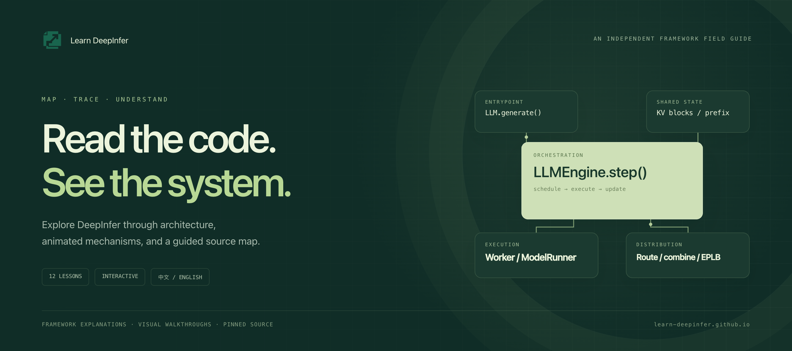

<div align="center">

[English](README.md) · [简体中文](README.zh-CN.md)

<a href="https://learn-deepinfer.github.io/en/"></a>

# Learn DeepInfer

**Understand DeepInfer through architecture, animated mechanisms, and guided source reading.**

[](https://learn-deepinfer.github.io/en/) [](https://learn-deepinfer.github.io/en/timeline/) [](https://learn-deepinfer.github.io/en/) [](LICENSE)

**[Start learning ↗](https://learn-deepinfer.github.io/en/)**　·　**[Architecture map ↗](https://learn-deepinfer.github.io/en/layers/)**　·　**[Source map](docs/source-map.md)**

</div>

---

How does a request enter the engine? Who chooses the next round of work? How is state reused, and how do tokens reach experts? **Learn DeepInfer** connects these questions across 12 bilingual lessons, with visual explanations and pinned source references.

> A visual field guide to the DeepInfer framework: architecture, mechanisms, conceptual equations, and source reading. Interactive examples use preset states to explain each mechanism.

## Start with the system map

Identify four responsibilities, then connect them by following a request. This is the course map; the actual request chain appears below.


## One mechanism at a time

| Responsibility | Lessons | The question to answer |
| :--- | :--- | :--- |
| **01 · Engine orchestration** | [s01 Request lifecycle](https://learn-deepinfer.github.io/en/s01/) · [s02 Execution boundaries](https://learn-deepinfer.github.io/en/s02/) · [s04 Sampling & state](https://learn-deepinfer.github.io/en/s04/) | Who accepts requests, runs a round, and updates state? |
| **02 · State management** | [s03 KV cache](https://learn-deepinfer.github.io/en/s03/) · [s07 Block mapping](https://learn-deepinfer.github.io/en/s07/) · [s08 Prefix reuse](https://learn-deepinfer.github.io/en/s08/) | How does logical context map to reusable storage? |
| **03 · Scheduling & coordination** | [s05 Batching](https://learn-deepinfer.github.io/en/s05/) · [s06 Continuous scheduling](https://learn-deepinfer.github.io/en/s06/) · [s09 DSpark](https://learn-deepinfer.github.io/en/s09/) · [s10 Execution overlap](https://learn-deepinfer.github.io/en/s10/) | What runs this round, and which stages can overlap? |
| **04 · Experts & balance** | [s11 Expert routing](https://learn-deepinfer.github.io/en/s11/) · [s12 EPLB](https://learn-deepinfer.github.io/en/s12/) | Where do tokens go, and where do expert replicas belong? |

## Trace a request through the source

`LLM.generate` creates and enqueues requests. `LLMEngine.step` coordinates rounds; the Scheduler selects work; Worker and ModelRunner organize execution; postprocessing advances request state. A step may cover multiple requests, prompt chunks, or draft verification.


| Source entry | What to follow |
| :--- | :--- |
| [`entrypoints/llm.py`](https://github.com/deepseek-ai/DeepInfer/blob/8b16149741a4935e1dec8cea27853f273b374c5b/deepinfer/entrypoints/llm.py) | Request admission, output collection, and return |
| [`engine/llm_engine.py`](https://github.com/deepseek-ai/DeepInfer/blob/8b16149741a4935e1dec8cea27853f273b374c5b/deepinfer/engine/llm_engine.py) | Round orchestration and engine state |
| [`csrc/engine/scheduler.hpp`](https://github.com/deepseek-ai/DeepInfer/blob/8b16149741a4935e1dec8cea27853f273b374c5b/csrc/engine/scheduler.hpp) | Request selection, budgets, and block planning |
| [`worker/worker.py`](https://github.com/deepseek-ai/DeepInfer/blob/8b16149741a4935e1dec8cea27853f273b374c5b/deepinfer/worker/worker.py) · [`model_runner.py`](https://github.com/deepseek-ai/DeepInfer/blob/8b16149741a4935e1dec8cea27853f273b374c5b/deepinfer/worker/model_runner.py) | Execution coordination, sampling, and deferred processing |
| [`worker/cache_engine.py`](https://github.com/deepseek-ai/DeepInfer/blob/8b16149741a4935e1dec8cea27853f273b374c5b/deepinfer/worker/cache_engine.py) | Cache-state organization and storage |
| [`model_executor/eplb/policy.py`](https://github.com/deepseek-ai/DeepInfer/blob/8b16149741a4935e1dec8cea27853f273b374c5b/deepinfer/model_executor/eplb/policy.py) | Expert replica allocation and placement |

Source references are pinned to [`DeepInfer@8b16149`](https://github.com/deepseek-ai/DeepInfer/tree/8b16149741a4935e1dec8cea27853f273b374c5b) · **[Open the complete source map →](docs/source-map.md)**

## See the state change

<a href="https://learn-deepinfer.github.io/en/s06/?tab=lab"></a>

| Observe | Interact | Connect |
| :--- | :--- | :--- |
| Batch admission, cache reuse, draft verification, expert dispatch | Step, play, or scrub; transitions connect consecutive states | Chapter comparison, bilingual explanations, pinned source entries |

**[Explore continuous batching ↗](https://learn-deepinfer.github.io/en/s06/?tab=lab)**　·　**[Explore expert routing ↗](https://learn-deepinfer.github.io/en/s11/?tab=lab)**　·　**[Compare two chapters ↗](https://learn-deepinfer.github.io/en/compare/)**

The website includes light and dark themes, course search, mobile layouts, and reading progress stored in your browser.

<details>
<summary>Expand the website preview</summary>

<a href="https://learn-deepinfer.github.io/en/"></a>

</details>

## Put the relationships into equations


<details>
<summary><strong>Expand equations and definitions</strong></summary>

The notation describes responsibilities at a conceptual level. Read the source for concrete admission conditions, cache formats, and routing rules.

**Round budget** — $\mathcal{S}_t$ is the selected request set; $q_i$ is token work assigned to request $i$, and $B_t$ is the round budget.

$$
\sum_{i\in\mathcal{S}_t}q_i\leq B_t
$$

**Block addressing** — $t$ is a zero-based position, $P$ is block size, and $\mathrm{table}[b]$ resolves the physical block.

$$
b=\left\lfloor t/P\right\rfloor,\quad o=t\bmod P,\quad p=\mathrm{table}[b]
$$

**Prefix identity** — A parent prefix, token block, and relevant context identify reusable state. $H$ denotes a conceptual identity function.

$$
K=H\!\left(K_{\mathrm{parent}},\;\mathrm{tokens},\;\mathrm{context}\right)
$$

**Expert combination** — $E_e$ is an expert function, $w_e$ its combine weight, and $\mathcal{S}(x)$ the routed expert set. Shared experts and routing-specific details are omitted.

$$
y=\sum_{e\in\mathcal{S}(x)}w_eE_e(x)
$$

</details>

**[Read the illustrated architecture guide →](docs/architecture.md)** · Continue with paged state, continuous batching, and MoE routing.

## Develop the website

With Node.js 22, run from the repository root:

```bash
git clone https://github.com/learn-deepinfer/learn-deepinfer.github.io.git
cd learn-deepinfer.github.io/web
npm ci
npm run dev
```

Open [localhost:5178/en/](http://127.0.0.1:5178/en/) · `npm run build` builds 32 Chinese and English route documents.

```text
web/src/data/          Bilingual lessons and DeepInfer source references
web/src/components/    Interactive mechanisms and state transitions
docs/                  Architecture guides, source map, deployment notes
docs/diagrams/         Editable frontend diagram sources
docs/assets/diagrams/  Rendered figures for the README and guides
```

[Deployment notes](docs/deployment.md) · [Render the diagrams](docs/diagrams/README.md)

## Help make it clearer

Contributions are welcome: clearer diagrams, source-map corrections, translations, and more readable state transitions. Link content changes to upstream source; run `npm run build` for website changes.

[Open an issue](https://github.com/learn-deepinfer/learn-deepinfer.github.io/issues) · [Send a pull request](https://github.com/learn-deepinfer/learn-deepinfer.github.io/pulls)

## Credits & license

An independent community learning project about [deepseek-ai/DeepInfer](https://github.com/deepseek-ai/DeepInfer). The progressive course structure and documentation design draw inspiration from [shareAI-lab/learn-claude-code](https://github.com/shareAI-lab/learn-claude-code).

[Apache-2.0](LICENSE) · [Third-party notices](THIRD_PARTY_NOTICES.md)

---

<div align="center">

**Understand each mechanism in the context of the whole system.**

[Start reading ↗](https://learn-deepinfer.github.io/en/)

</div>
