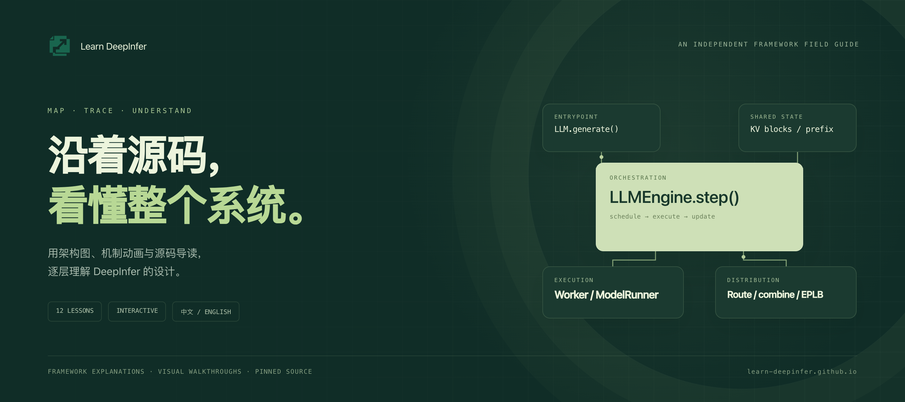
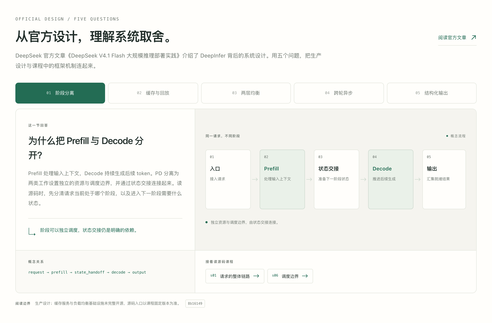
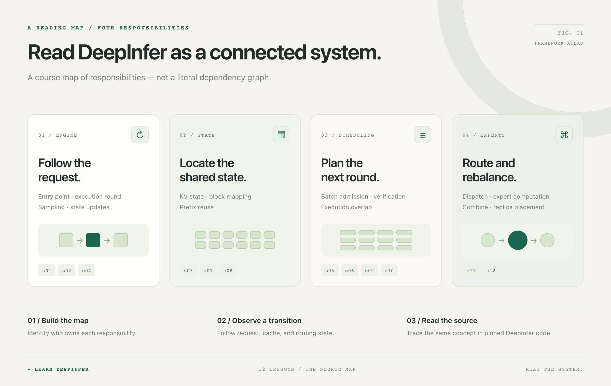
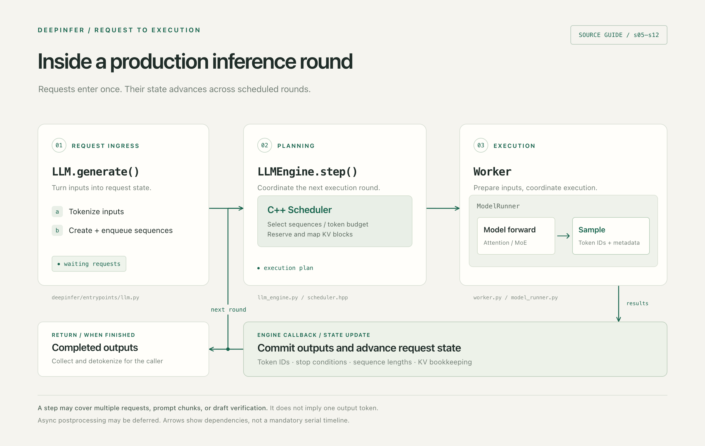
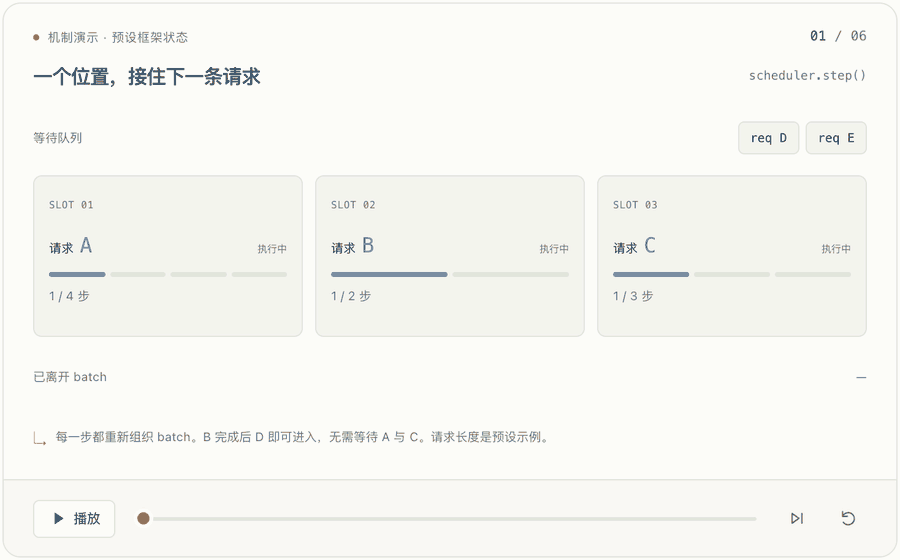
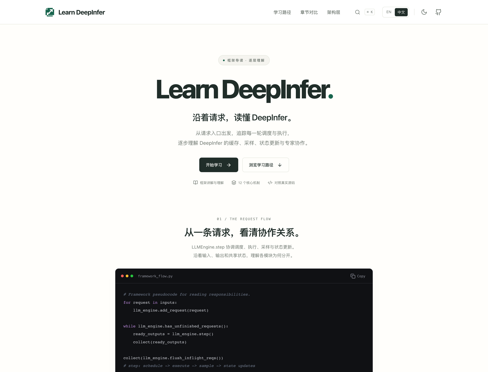
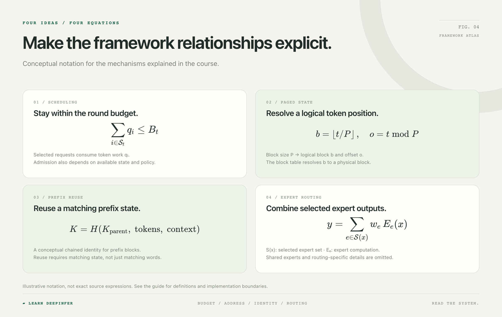

<div align="center">

[English](README.md) · [简体中文](README.zh-CN.md)

<a href="https://learn-deepinfer.github.io/zh/"></a>

# Learn DeepInfer

**用架构图、机制动画和源码导读，逐层理解 DeepInfer。**

[](https://learn-deepinfer.github.io/zh/) [](https://learn-deepinfer.github.io/zh/timeline/) [](https://learn-deepinfer.github.io/zh/) [](LICENSE)

**[开始学习 ↗](https://learn-deepinfer.github.io/zh/)**　·　**[架构地图 ↗](https://learn-deepinfer.github.io/zh/layers/)**　·　**[源码索引](docs/source-map.md)**

</div>

---

一条请求如何进入引擎？调度器怎样决定下一轮工作？状态如何复用，token 又如何到达专家？**Learn DeepInfer** 把这些问题拆成 12 节双语课程，让模块职责、状态变化和源码位置一一对应。

> 项目定位：DeepInfer 框架讲解与理解。课程围绕架构、机制、概念公式和源码阅读展开；交互演示使用预设状态展示机制。

> **从官方设计读起** · [八个问题理解阶段分工、状态复用与调度 →](docs/official-design.zh-CN.md)
> 对照 DeepSeek 官方文章阅读，分清设计动机、公开源码与内部组件的边界。

[](https://learn-deepinfer.github.io/zh/layers/)

点图进入[网站架构地图](https://learn-deepinfer.github.io/zh/layers/)，把官方设计问题放回课程主线。

## 从全局地图开始

先辨认四类职责，再沿着具体请求把它们连接起来。下图是课程的组织方式；模块的实际调用关系见后面的请求链路。



## 每次弄懂一个机制

| 学习层次 | 章节 | 读完能回答的问题 |
| :--- | :--- | :--- |
| **01 · 引擎编排** | [s01 请求生命周期](https://learn-deepinfer.github.io/zh/s01/) · [s02 执行边界](https://learn-deepinfer.github.io/zh/s02/) · [s04 采样与状态](https://learn-deepinfer.github.io/zh/s04/) | 谁接收请求、谁执行一轮、谁更新状态？ |
| **02 · 状态管理** | [s03 KV cache](https://learn-deepinfer.github.io/zh/s03/) · [s07 分页映射](https://learn-deepinfer.github.io/zh/s07/) · [s08 前缀复用](https://learn-deepinfer.github.io/zh/s08/) | 逻辑上下文如何关联可复用的存储？ |
| **03 · 调度与协作** | [s05 批处理](https://learn-deepinfer.github.io/zh/s05/) · [s06 连续调度](https://learn-deepinfer.github.io/zh/s06/) · [s09 DSpark](https://learn-deepinfer.github.io/zh/s09/) · [s10 执行重叠](https://learn-deepinfer.github.io/zh/s10/) | 这一轮做什么，哪些阶段可以交错？ |
| **04 · 专家与均衡** | [s11 专家路由](https://learn-deepinfer.github.io/zh/s11/) · [s12 EPLB](https://learn-deepinfer.github.io/zh/s12/) | token 去哪里，专家副本又放在哪里？ |

## 沿着一条请求读源码

`LLM.generate` 创建并加入请求，`LLMEngine.step` 协调轮次，Scheduler 选择本轮工作，Worker 与 ModelRunner 组织执行，再通过后处理推进请求状态。一次 step 可能包含多条请求、prompt 分块或草稿验证。



| 阅读入口 | 关注职责 |
| :--- | :--- |
| [`entrypoints/llm.py`](https://github.com/deepseek-ai/DeepInfer/blob/8b16149741a4935e1dec8cea27853f273b374c5b/deepinfer/entrypoints/llm.py) | 请求加入、结果收集与返回 |
| [`engine/llm_engine.py`](https://github.com/deepseek-ai/DeepInfer/blob/8b16149741a4935e1dec8cea27853f273b374c5b/deepinfer/engine/llm_engine.py) | 轮次编排与引擎状态 |
| [`csrc/engine/scheduler.hpp`](https://github.com/deepseek-ai/DeepInfer/blob/8b16149741a4935e1dec8cea27853f273b374c5b/csrc/engine/scheduler.hpp) | 请求选择、预算与缓存块安排 |
| [`worker/worker.py`](https://github.com/deepseek-ai/DeepInfer/blob/8b16149741a4935e1dec8cea27853f273b374c5b/deepinfer/worker/worker.py) · [`model_runner.py`](https://github.com/deepseek-ai/DeepInfer/blob/8b16149741a4935e1dec8cea27853f273b374c5b/deepinfer/worker/model_runner.py) | 执行衔接、采样与延后处理 |
| [`worker/cache_engine.py`](https://github.com/deepseek-ai/DeepInfer/blob/8b16149741a4935e1dec8cea27853f273b374c5b/deepinfer/worker/cache_engine.py) | 缓存状态的组织与存储 |
| [`model_executor/eplb/policy.py`](https://github.com/deepseek-ai/DeepInfer/blob/8b16149741a4935e1dec8cea27853f273b374c5b/deepinfer/model_executor/eplb/policy.py) | 专家副本分配与布局策略 |

阅读参考固定在 [`DeepInfer@8b16149`](https://github.com/deepseek-ai/DeepInfer/tree/8b16149741a4935e1dec8cea27853f273b374c5b) · **[打开完整源码地图 →](docs/source-map.md)**

## 看见机制怎样变化

<a href="https://learn-deepinfer.github.io/zh/s06/?tab=lab"></a>

| 观察 | 操作 | 对照 |
| :--- | :--- | :--- |
| 请求进出 batch、缓存计算与复用、草稿验证、专家分发 | 单步、播放、拖动进度；过渡动画连接前后状态 | 章节对比、双语讲解、固定版本源码入口 |

**[试试连续批处理 ↗](https://learn-deepinfer.github.io/zh/s06/?tab=lab)**　·　**[看看专家路由 ↗](https://learn-deepinfer.github.io/zh/s11/?tab=lab)**　·　**[比较两个章节 ↗](https://learn-deepinfer.github.io/zh/compare/)**

网站同时支持深浅主题、课程搜索、移动端阅读，以及保存在当前浏览器的学习进度。

<details>
<summary>展开网站预览</summary>

<a href="https://learn-deepinfer.github.io/zh/"></a>

</details>

## 用公式理解框架关系



<details>
<summary><strong>展开公式与符号说明</strong></summary>

下面使用概念记号，帮助理解模块职责；具体准入条件、缓存格式和路由规则请结合源码阅读。

**调度预算** — $\mathcal{S}_t$ 为本轮选中的请求集合，$q_i$ 是分配给请求 $i$ 的 token 工作量，$B_t$ 为本轮预算。

$$
\sum_{i\in\mathcal{S}_t}q_i\leq B_t
$$

**分页寻址** — $t$ 为从零开始的位置，$P$ 为块大小，$\mathrm{table}[b]$ 给出物理块。

$$
b=\left\lfloor t/P\right\rfloor,\quad o=t\bmod P,\quad p=\mathrm{table}[b]
$$

**前缀身份** — 用父前缀、当前 token 块和相关上下文共同区分可复用状态；这里的 $H$ 是概念函数。

$$
K=H\!\left(K_{\mathrm{parent}},\;\mathrm{tokens},\;\mathrm{context}\right)
$$

**专家合并** — $E_e$ 是专家计算，$w_e$ 为合并权重，$\mathcal{S}(x)$ 是路由器选中的专家集合。图中省略共享专家及模型特定路由细节。

$$
y=\sum_{e\in\mathcal{S}(x)}w_eE_e(x)
$$

</details>

**[阅读架构图解 →](docs/architecture.zh-CN.md)** · 包含分页状态、连续批处理和 MoE 路由的展开说明。

## 本地编辑网站

Node.js 22；在仓库根目录执行：

```bash
git clone https://github.com/learn-deepinfer/learn-deepinfer.github.io.git
cd learn-deepinfer.github.io/web
npm ci
npm run dev
```

打开 [localhost:5178/zh/](http://127.0.0.1:5178/zh/) · `npm run build` 生成 32 个中英文静态页面。

```text
web/src/data/          双语课程与 DeepInfer 源码入口
web/src/components/    交互机制与状态过渡动画
docs/                  架构导读、源码地图与部署说明
docs/diagrams/         可编辑的前端制图源文件
docs/assets/diagrams/  README 与文档使用的高清图解
```

[部署说明](docs/deployment.md) · [重新导出图解](docs/diagrams/README.md)

## 一起把它讲清楚

欢迎补充更直观的图解、纠正源码映射、完善翻译，或指出机制演示里不清楚的状态变化。内容改动请附对应的上游源码位置；网站改动请运行 `npm run build`。

[提出问题](https://github.com/learn-deepinfer/learn-deepinfer.github.io/issues) · [提交改进](https://github.com/learn-deepinfer/learn-deepinfer.github.io/pulls)

## 致谢与许可

独立的社区学习项目，围绕 [deepseek-ai/DeepInfer](https://github.com/deepseek-ai/DeepInfer)。课程组织与文档设计参考 [shareAI-lab/learn-claude-code](https://github.com/shareAI-lab/learn-claude-code)。

设计解读参考 DeepSeek 官方[《DeepSeek V4.1 Flash 大规模推理部署实践》](https://zhuanlan.zhihu.com/p/2095560295930508953)，由本项目整理为独立的学习导读。

[Apache-2.0](LICENSE) · [Third-party notices](THIRD_PARTY_NOTICES.md)

---

<div align="center">

**把每个机制，放回整个系统。**

[开始阅读 ↗](https://learn-deepinfer.github.io/zh/)

</div>
