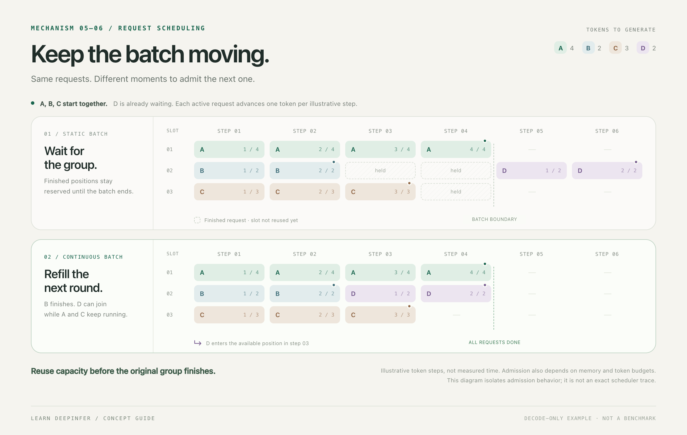
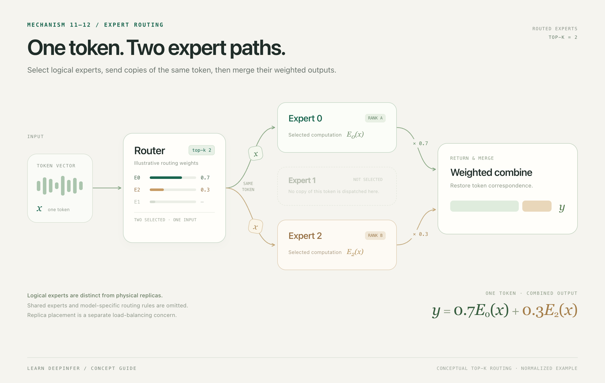

# A source guide to DeepInfer's architecture

[简体中文](architecture.zh-CN.md) · [Course](https://learn-deepinfer.github.io/en/) · [Source map](source-map.md)

DeepInfer is easier to read when a request, a scheduling round, and a returned result are treated as different objects. This guide follows the framework's responsibilities and the state passed between them. All upstream links refer to [commit `8b16149741a4935e1dec8cea27853f273b374c5b`](https://github.com/deepseek-ai/DeepInfer/tree/8b16149741a4935e1dec8cea27853f273b374c5b).

The diagrams summarize relationships. The equations express teaching constraints; they are not transcriptions of every condition in the upstream implementation.

## 1. Start with responsibility boundaries

The diagram groups lessons into four layers. The table below follows responsibilities along a request: entry and execution coordination sit within engine coordination, state spans stages, scheduling selects work, and expert routing sits inside execution. These are two views of the same framework.

Read the framework through four questions:

| Responsibility | Question to ask | Reading entry |
| --- | --- | --- |
| Request entry | What is accepted, normalized, and assigned an identity? | `LLM.generate`, `LLM._add_request` |
| Scheduling | Which requests are eligible for this round, and which work fits? | `Scheduler::_schedule`, `_schedule_prefill`, `_schedule_decode` |
| State management | Which sequence positions, cache blocks, and ownership records survive between rounds? | `Sequence`, `BlockManager`, `CacheEngine` |
| Execution coordination | When is work submitted, when is a result usable, and when can it be released? | `Worker.execute_model_step`, `LLMEngine.step` |

A request can span many rounds. A round can cover several requests. A result can become available after the round that submitted its work. Keep those three distinctions when following the arrows.

## 2. Follow a request through the framework

[`LLM.generate`](https://github.com/deepseek-ai/DeepInfer/blob/8b16149741a4935e1dec8cea27853f273b374c5b/deepinfer/entrypoints/llm.py#L90) normalizes its inputs, adds requests, and enters `_run_engine`. `_add_request` copies the sampling parameters, assigns a request ID, and passes normalized input IDs to `LLMEngine.add_request`.

[`LLMEngine.step`](https://github.com/deepseek-ai/DeepInfer/blob/8b16149741a4935e1dec8cea27853f273b374c5b/deepinfer/engine/llm_engine.py#L860) obtains scheduling outputs and sequence metadata. It also coordinates cache-state operations before passing the round to workers. The scheduler's output is an execution plan for a round, rather than the final response to a request.

[`LLM._run_engine`](https://github.com/deepseek-ai/DeepInfer/blob/8b16149741a4935e1dec8cea27853f273b374c5b/deepinfer/entrypoints/llm.py#L168) collects the available outputs by request ID. When unfinished requests are gone, it still calls `flush_inflight_reqs` to collect pending results. It clones returned output objects before retaining them, because their pooled storage is released on a later step.

For a detailed first pass, read [Chapter 1: a request's lifecycle](chapter-01.md).

## 3. Read scheduling as admission under constraints

Static batching fixes a group's membership until that group completes. Continuous batching revisits membership between rounds, allowing eligible waiting work to enter available capacity. The diagram explains this distinction; it is not a line-by-line model of DeepInfer's complete scheduler.

A useful starting constraint is:

$$
\sum_{i\in\mathcal{A}_t}q_i\le B_t.
$$

Here $\mathcal{A}_t$ is the set admitted in round $t$, $q_i$ is the number of input positions scheduled for request $i$ in that round, and $B_t$ is a teaching token budget. It is not the request's entire remaining output length.

**Prefill** processes existing input to establish state; **decode** continues generation using that state. A **chunk** is a portion of input processed together, and a **draft** is a candidate sequence awaiting verification. Keep existing state, positions processed this round, and newly confirmed output separate.

The actual scheduler also considers sequence status, allocatable blocks, phase-specific limits, chunk boundaries, and coordination between participants. Prefill work can be chunked. Draft verification can make a request's work differ from a single-token decode step. The inequality is therefore one constraint, not a complete scheduling policy or a timing formula.

Read [`scheduler.hpp`](https://github.com/deepseek-ai/DeepInfer/blob/8b16149741a4935e1dec8cea27853f273b374c5b/csrc/engine/scheduler.hpp#L275) with a small paper ledger: waiting requests, scheduled requests, allocated blocks, and finished requests. At each branch, record which entry changes and why.

## 4. Separate sequence order from cache placement

A request has a logical token order. Its cached state can occupy blocks whose physical order differs from that sequence order. A conceptual page lookup is:

$$
u=\left\lfloor\frac{t}{P}\right\rfloor,\qquad o=t\bmod P,\qquad p=\operatorname{BlockTable}[r,u].
$$

$r$ identifies a request, $t$ is its zero-based token position, $P$ is positions per page, $u$ is the logical page, $o$ is the offset inside it, and $p$ identifies the physical page. This is an address-translation concept, not a claim about the exact layout or compressed state representation used by upstream code.

Read [`BlockManager`](https://github.com/deepseek-ai/DeepInfer/blob/8b16149741a4935e1dec8cea27853f273b374c5b/csrc/engine/block_manager.hpp#L119) for ownership and allocation, then [`CacheEngine`](https://github.com/deepseek-ai/DeepInfer/blob/8b16149741a4935e1dec8cea27853f273b374c5b/deepinfer/worker/cache_engine.py#L851) for the cache-state operations coordinated during execution. Allocation, retention, cloning, and release are separate transitions.

Prefix sharing requires more than equal visible text. As a teaching invariant:

$$
\operatorname{Share}(a,b,\ell)\Rightarrow
\operatorname{Tokens}_a[:\ell]=\operatorname{Tokens}_b[:\ell]
\;\land\;\operatorname{CompatibleState}(a,b,\ell)
\;\land\;\operatorname{SafeWrites}(a,b,\ell).
$$

The shared input prefix must match, its computation and positional state must be compatible, and later writes must preserve the other request's state. Compatibility can involve configuration, cache format, version, and auxiliary state. These are necessary conceptual conditions, not a sufficient cache-hit algorithm. The upstream release's internal cache machinery should also be distinguished from the additional service-level cache system described in its README.

## 5. Track submitted work separately from completed work

[`Worker.execute_model_step`](https://github.com/deepseek-ai/DeepInfer/blob/8b16149741a4935e1dec8cea27853f273b374c5b/deepinfer/worker/worker.py#L89) documents an important order: submit the current round's forward work, post-process the previous round, perform the current round's sampling, and decide whether to defer its post-processing.

With asynchronous scheduling enabled, decode post-processing can be deferred to the next round. The framework must keep the corresponding metadata and resources alive until that dependency is resolved. [`_correct_seqlens_qk`](https://github.com/deepseek-ai/DeepInfer/blob/8b16149741a4935e1dec8cea27853f273b374c5b/deepinfer/worker/worker.py#L191) is one place to inspect how sequence metadata is corrected across that boundary.

An arrow to “output” means a dependency, not a promise that every submission returns its final result immediately. Distinguish the current round's work, the previous round's post-processing, and the request outputs ready for collection.

## 6. Separate logical experts from their placement

The conceptual routed-expert result for token $i$ is:

$$
y_i=\sum_{e\in\mathcal{S}_i}\alpha_{i,e}\,E_e(x_i).
$$

$x_i$ is a token representation, $\mathcal{S}_i$ is its selected logical expert set, $E_e$ denotes expert $e$'s contribution, and $\alpha_{i,e}$ is the corresponding routing weight. This teaching formula omits shared branches, score processing, and other framework-specific details.

Dispatch organizes the representations for the selected experts. Combine restores token correspondence and merges the contributions. Expert parallel load balancing changes placement and replica assignment; it should not be described as arbitrarily changing which logical expert function a token requested.

Read [`v4_modules/moe.py`](https://github.com/deepseek-ai/DeepInfer/blob/8b16149741a4935e1dec8cea27853f273b374c5b/deepinfer/model_executor/models/v4_modules/moe.py), [`v4_modules/mlp.py`](https://github.com/deepseek-ai/DeepInfer/blob/8b16149741a4935e1dec8cea27853f273b374c5b/deepinfer/model_executor/models/v4_modules/mlp.py), and [`rebalance_experts_global`](https://github.com/deepseek-ai/DeepInfer/blob/8b16149741a4935e1dec8cea27853f273b374c5b/deepinfer/model_executor/eplb/policy.py#L73) together. Trace logical expert IDs, physical placements, and token-to-result correspondence as separate records.

Continue with the [pinned source map](source-map.md). For every module, identify its input, owned state, output, and release point before reading its optimizations.

For the reasons behind these boundaries, read the [official system design guide](official-design.md) or explore the website's [switchable architecture diagrams](https://learn-deepinfer.github.io/en/layers/). The guide distinguishes the production design described in the official article from the pinned open-source implementation.
