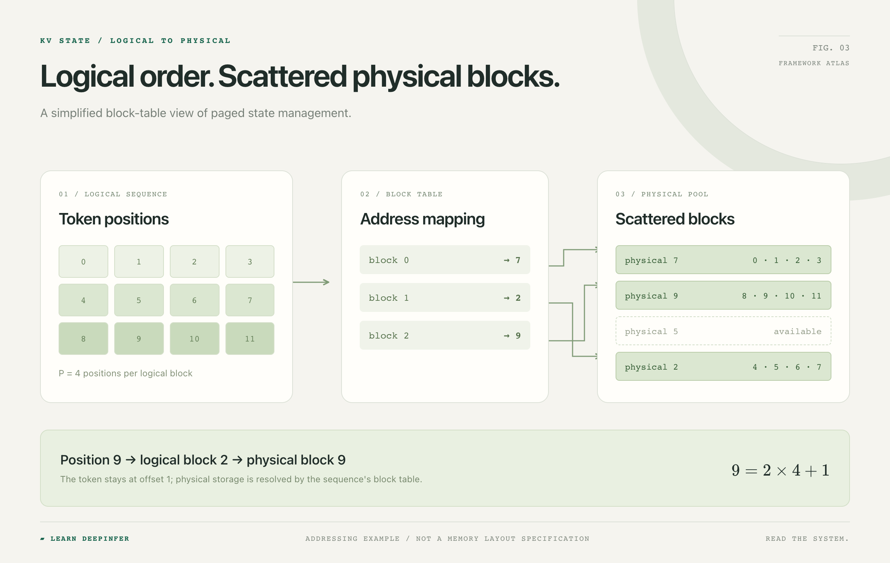

# 第一章：一条请求在 DeepInfer 中的生命周期

这一章沿着 DeepInfer 的真实源码，追踪请求从进入框架到输出回收的过程。阅读目标是建立职责和状态的对应关系。上游版本固定为 [`8b16149741a4935e1dec8cea27853f273b374c5b`](https://github.com/deepseek-ai/DeepInfer/tree/8b16149741a4935e1dec8cea27853f273b374c5b)。

先记住三个单位：**请求**是需要完成的任务，**step** 是一次调度与执行轮次，**输出**是已经就绪、可以交给调用方的结果记录。三者不一一对应。

## 1. 入口先建立请求身份

从 [`LLM.generate`](https://github.com/deepseek-ai/DeepInfer/blob/8b16149741a4935e1dec8cea27853f273b374c5b/deepinfer/entrypoints/llm.py#L90) 开始。它把输入组织成请求集合，处理默认采样参数，逐条调用 `_add_request`，最后进入 `_run_engine`。

[`LLM._add_request`](https://github.com/deepseek-ai/DeepInfer/blob/8b16149741a4935e1dec8cea27853f273b374c5b/deepinfer/entrypoints/llm.py#L144) 负责复制参数、生成请求 ID，并把输入 IDs 规范化后交给 `LLMEngine.add_request`。复制参数可以避免不同请求意外共享一份会变化的配置。

这一段先追踪四件东西：请求 ID、输入 IDs、采样参数和附加输入。不要把“已经加入引擎”理解成“本轮一定会执行”。请求还需要等待调度器决定准入。

## 2. Sequence 把请求变成可调度状态

阅读 [`LLMEngine.add_request`](https://github.com/deepseek-ai/DeepInfer/blob/8b16149741a4935e1dec8cea27853f273b374c5b/deepinfer/engine/llm_engine.py#L472)，再转到 [`Sequence`](https://github.com/deepseek-ai/DeepInfer/blob/8b16149741a4935e1dec8cea27853f273b374c5b/csrc/engine/sequence.hpp#L275)。此时要从用户输入转向框架内部的状态记录。

| 要追踪的记录 | 阅读时的问题 |
| --- | --- |
| 请求身份与参数 | 后续结果靠什么回到原请求？ |
| 已有输入与输出位置 | 下一轮还有哪些位置需要处理？ |
| 调度状态 | 请求仍在等待、正在执行，还是已经结束？ |
| 缓存与块记录 | 哪些状态已经存在，哪些需要分配或释放？ |
| 结束原因 | 正常结束、长度限制与取消如何走向回收？ |

等待、执行、完成是阅读时的简化分类。实际枚举还区分多种结束状态，以 [`SequenceStatus`](https://github.com/deepseek-ai/DeepInfer/blob/8b16149741a4935e1dec8cea27853f273b374c5b/csrc/engine/sequence.hpp#L30) 为准。

图说明序列位置与物理存储的关系：输入有逻辑顺序，缓存块的物理顺序可以不同。阅读 Sequence 的块记录时，把逻辑位置、块表映射和物理块所有权分开追踪。

## 3. step 从调度计划开始

[`LLMEngine.step`](https://github.com/deepseek-ai/DeepInfer/blob/8b16149741a4935e1dec8cea27853f273b374c5b/deepinfer/engine/llm_engine.py#L860) 首先取得调度结果与序列元数据。再读 [`Scheduler::_schedule`](https://github.com/deepseek-ai/DeepInfer/blob/8b16149741a4935e1dec8cea27853f273b374c5b/csrc/engine/scheduler.hpp#L275)，观察它如何选择阶段与请求。

可以先用 token 预算辅助记账：

$$
\sum_{i\in\mathcal{A}_t}q_i\le B_t.
$$

$\mathcal{A}_t$ 是本轮准入集合，$q_i$ 是本轮分配给请求 $i$ 的输入位置数，$B_t$ 是教学抽象中的总预算。这个关系帮助区分请求长度与本轮工作量；实际调度还涉及可分配块、状态、分块规则和其他限制。

调度结果既包含本轮要执行的序列，也可能要求克隆或清理缓存状态。`LLMEngine.step` 在进入 worker 前协调这些操作。因此“调度”不仅是从列表里挑几条请求，还要保证后续执行所依赖的状态成立。

## 4. 执行提交与状态落账可以跨轮

进入 [`Worker.execute_model_step`](https://github.com/deepseek-ai/DeepInfer/blob/8b16149741a4935e1dec8cea27853f273b374c5b/deepinfer/worker/worker.py#L89)。它协调当前轮工作、前一轮后处理与当前轮采样。异步调度允许 decode 的后处理推迟到下一轮，相关状态也要保留到对应结果可消费时。

具体完成时机以 worker 的分支和回调为准。`ModelRunner` 负责把本轮元数据组织成执行输入，并返回后续阶段需要的结果与元数据。读这一层时，重点是输入、输出和生命周期。

这里有两个容易混淆的地方：一次 step 不保证每条请求恰好增加一个 token；刚选出的 token 也不因此自动拥有自己的缓存状态。状态何时建立，需要追踪它作为输入被后续前向处理的时机。包含 draft 验证或占位轮次时，更不能按一轮一个 token 推断。

## 5. 结果返回还涉及对象所有权

回到 [`LLM._run_engine`](https://github.com/deepseek-ai/DeepInfer/blob/8b16149741a4935e1dec8cea27853f273b374c5b/deepinfer/entrypoints/llm.py#L168)。它按请求 ID 收集输出，在保留对象前先调用 `RequestOutput.clone`，最后按输入请求顺序组织返回值。

clone 的原因可以直接在 `LLMEngine.step` 的文档中找到：返回的输出对象由对象池管理，后续 step 会释放相应存储。保存一个引用与获得可独立保留的结果不是同一件事。

循环还有一个收尾动作：没有未完成请求后，调用 `flush_inflight_reqs`，让在途结果完成后处理并被收集。只检查“等待与运行队列是否为空”，可能漏掉已经发出但尚未落账的工作。

## 6. 用一张状态账本检查理解

这是一份源码阅读练习，不需要执行任何请求：

1. 画出两条请求 A、B，分别记录 request ID、输入位置、调度状态和块所有权。
2. 在 `_schedule_prefill` 中找出一个让请求继续等待的分支，写出它缺少的条件。
3. 在 `Worker.execute_model_step` 中分别标出“当前轮”和“前一轮”的状态，追踪后处理什么时候消费它们。
4. 找到输出 clone 与 `flush_inflight_reqs`，解释为什么结束判断之后仍有资源和结果需要收尾。
5. 用自己的话区分请求入队、请求准入、执行提交、输出可读和资源释放。

接着读[源码地图](source-map.md)和[架构导读](architecture.zh-CN.md)，把这条主链扩展到分页、前缀共享、连续批处理和专家路由。
